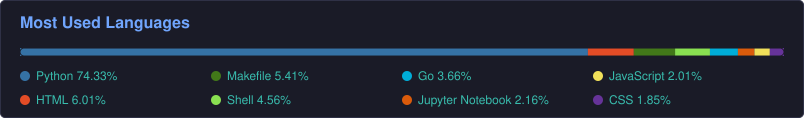
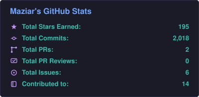

<h1 align="center">Maziar Sojoudian</h1>
<!-- <h5 align="center">Just a Software Engineer</h5> 
-->
<!-- ### Hi there 👋

My name is Maziar and I'm just an ordinary Software Engineer. -->

<!--
**sojoudian/sojoudian** is a ✨ _special_ ✨ repository because its `README.md` (this file) appears on your GitHub profile.

Here are some ideas to get you started:
-->

### 🛠 My Favorite Languages & Tools

&nbsp;
&nbsp;
&nbsp;
&nbsp;
&nbsp;
&nbsp;

&nbsp;
&nbsp;
&nbsp;

&nbsp;
&nbsp;
&nbsp;

&nbsp;
&nbsp;
&nbsp;

&nbsp;
&nbsp; 

&nbsp;

&nbsp;
&nbsp;
&nbsp;

&nbsp;
&nbsp;
&nbsp;
&nbsp;
&nbsp;
&nbsp;
&nbsp;
&nbsp;

### 👨‍💻 About me

- 🔭 I’m currently working on Audio and Video streaming applications and hosting them on the public and private clouds.
- 🌱 I’m currently learning Concurrency, Parallel and Distributed Computing, and Multithreading Programming.
- 🤖 I’m looking to collaborate on Open-source software projects
- 🤔 I’m looking for help with Apache Spark
- 💬 Ask me about Linux, Virtualization, Cloud, DevOps, Python, Recommendation systems, Knowledge Graphs, Graph databases, and others.
- 👽 Take a look at my Python best practices for Testdome tests [testdome_python](https://github.com/sojoudian/testdome_python) repository
- 😄 Pronunciation: mɑziɑr

### 📫 How to reach me:

  &nbsp;&nbsp;
  
  

   &nbsp;&nbsp;
  &nbsp;&nbsp;
  &nbsp;&nbsp;
  <!-- &nbsp;&nbsp; -->
  <!--  -->

<!-- [@sojodyan](http://twitter.com/sojodyan/) on twitter and 
 -->

<!-- 
   
 -->

### ⚙️ Analytics

<!-- These two cards are generated by .github/workflows/stats.yml and committed to this repository. -->

 

<!-- - ⚡ Fun fact: ... -->
